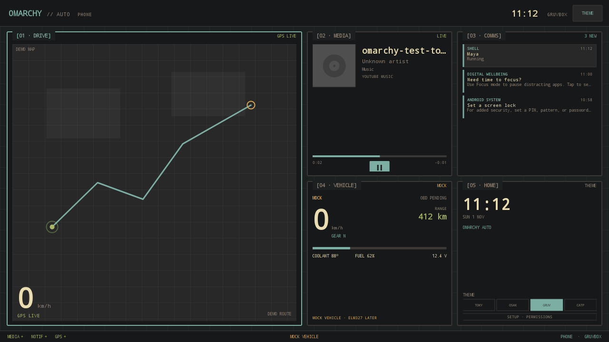

# Omarchy Auto

**An Omarchy-styled five-tile UI for Android Auto and Android phones.** The car
display is the primary target: a Car App Library **NavigationTemplate** app that
draws `Drive / Media / Comms / Vehicle / Home` on the Android Auto map surface.
The same Kotlin Canvas renderer powers a full-screen phone launcher.



*Phone launcher at 1280×720, opening with every tile minimized. This is the
clean-clone fallback background. The local phone build uses the supplied Tom
Ballard Tokyo Studio image via `local-assets/` (not committed); the visible test
metadata is not Android Auto footage.*

## Status — v0.1 redirect (2026-11-01)

The repository is **private until launch**; contributors are added explicitly.
The project pivoted from a Linux/Quickshell head unit to an Android target for
the fastest path to a real in-car demo. The Linux path remains in `shell/` and
in the docs archive as future work.

Built and checked on this machine:

- `./gradlew assembleDebug` produces two signed debug APKs.
- Phone launcher runs on an Android 15 emulator and a Samsung S24 FE (Android
  17). Theme switch, live MediaSession, live notifications, a GPS fix, stage
  selection, tile launch, Back return, and portrait/landscape rotation were
  exercised at 1280×720 and 1080×2400.
- The layout is now a **narrow right-side rail of small tiles** plus one large
  content stage. Tap a rail tile to engage it. Media has an in-app play/pause
  control; the stage `OPEN` button launches the real app.
- Android Auto APK compiles with the Car App Library navigation template and
  surface callback. **It has not been shown on a real Android Auto car screen.**
- The Desktop Head Unit was attempted, but the emulator image's Android Auto
  app is a Play Store stub and the image has no Play Store.

Live data is ordered as requested: clock + theme, now playing (MediaSession),
notifications (NotificationListener), GPS speed. The Vehicle tile remains a
visible mock; Torque is intentionally not wired up yet.

## Build

Prerequisites: JDK 17+ and Android SDK platform 37.

Toolchain: Gradle **9.8.2**, AGP **9.5.0**, built-in Kotlin (no separate KGP),
compileSdk **37**, targetSdk **36**. CI uses the current action runtimes
(`checkout@v7`, `setup-java@v6`, `setup-gradle@v6`, `upload-artifact@v7`) on
`ubuntu-26.04`; there is no Node/JavaScript app in this repository.

```sh
export ANDROID_HOME=/path/to/android-sdk
./gradlew assembleDebug
```

APKs:

```text
auto/build/outputs/apk/debug/auto-debug.apk
launcher/build/outputs/apk/debug/launcher-debug.apk
```

They are debug-signed. Verify with:

```sh
$ANDROID_HOME/build-tools/37.0.0/apksigner verify --print-certs \
  auto/build/outputs/apk/debug/auto-debug.apk
```

A clean clone only needs `ANDROID_HOME` (or `local.properties` with
`sdk.dir=...`). `local.properties` is ignored.

## Install and run

```sh
adb install -r auto/build/outputs/apk/debug/auto-debug.apk
adb install -r launcher/build/outputs/apk/debug/launcher-debug.apk
```

### Phone launcher

```sh
adb shell am start -n com.omarchy.auto.launcher/.MainActivity
```

Or choose **Omarchy Auto Launcher** as the home app. It is a five-tile demo
launcher, not a full app drawer.

The app opens with **all tiles minimized** — including Drive/navigation — so the
wallpaper is the first thing you see. Tap a rail tile to expand it; tap the same
tile again to minimize. The stage has an `OPEN` action for real apps:

| Rail tile | Stage | OPEN action |
|---|---|---|
| Drive | large demo map/GPS speed | Google Maps |
| Media | large now-playing/audio art + play/pause | Spotify, then YouTube Music |
| Comms | large notification list | default SMS app |
| Vehicle | large mock vehicle panel | none — Torque deferred |
| Home | clock, theme chips, setup | Android Settings |

Back from the launched app returns to the launcher. The top-right `THEME`
button cycles Tokyo Night, Osaka Jade, Gruvbox, and Catppuccin.

### Roadster background

The app looks for `wallpaper.jpg` (then legacy `roadster.jpg`) in its files
directory or the debug-only `local-assets/` directory. That file is **not committed**: the upstream Tokyo
Roadster theme's CREDITS says the media redistribution rights were not
established. A local copy makes the car/road wallpaper prominent; a clean clone
falls back to an original neon-road background. See
[`docs/ASSETS.md`](docs/ASSETS.md).

### Permissions

The phone launcher has a Home-tile `SETUP · PERMISSIONS` button. The Android
Auto APK also has a **Setup** launcher icon. The same grants can be made with
ADB:

```sh
adb shell cmd notification allow_listener \
  com.omarchy.auto/com.omarchy.auto.core.OmarchyNotificationListener
adb shell cmd notification allow_listener \
  com.omarchy.auto.launcher/com.omarchy.auto.core.OmarchyNotificationListener
adb shell pm grant com.omarchy.auto android.permission.ACCESS_FINE_LOCATION
adb shell pm grant com.omarchy.auto.launcher android.permission.ACCESS_FINE_LOCATION
```

Notification access enables both the Comms tile and MediaSession discovery.
Without it the UI says so instead of inventing data.

### Android Auto — private Play test

Android Auto does not trust an ADB-sideloaded Car App Library app. The reliable
private route is **Play Internal App Sharing**: it installs the build from Play,
without a public listing or review, and accepts a debuggable APK.

1. In Play Console, create an app with package name `com.omarchy.auto`.
2. **Test and release → Internal app sharing**, upload
   `auto/build/outputs/apk/debug/auto-debug.apk`.
3. Copy the sharing link. On the phone, uninstall the debug `com.omarchy.auto`
   package first, then open the link and install it from Play.
4. Open **Omarchy Auto setup** and grant notification access, location, and the
   service notification. [Setup screen](docs/img/setup-1280x720.png).
5. Connect the phone to the car over USB and launch **Omarchy Auto** from the
   Android Auto launcher. Unknown sources is not required for the Play-installed
   build.

The debug APK is re-signed by Internal App Sharing, so the old ADB-installed
copy must be removed first. This is still a private test app; it is not a public
release.

The car app uses the Car App Library **NAVIGATION** category. It draws the five
tiles into `NavigationTemplate`'s map surface through
`AppManager.setSurfaceCallback`. Android Auto owns the surrounding template and
action strip; the app adds a **Theme** action there. The canvas also has a
top-bar `THEME` button for hosts that forward surface clicks.

> **Sideloading caveat:** current Google documentation says the Android Auto
> "Unknown sources" developer option applies to media, messaging, and parked
> apps, but *not* to Car App Library apps. There is also a 2026 field report of
> sideloaded navigation apps disappearing from the AA launcher. Internal App
> Sharing / an Internal Test Track is the documented private test route. The
> debug build uses `HostValidator.ALLOW_ALL_HOSTS_VALIDATOR`; the release build
> now allows the official AA host certificates. Do not claim the car path works
> until it has been seen on a real host.

## Architecture

```text
core/                         shared Kotlin Android library
  Theme.kt                    4 Omarchy palettes
  Model.kt                    TileId, DashboardState, MediaSnapshot, NotificationItem
  TileRenderer.kt             one Canvas renderer for AA surface + phone View
  LiveDataStore / Controller  in-process state and source lifecycle
  MediaWatcher                MediaSessionManager + MediaController
  OmarchyNotificationListener NotificationListenerService
  LocationWatcher             GPS speed
  SetupActivity               permission setup

auto/                         Android Auto app (com.omarchy.auto)
  OmarchyCarAppService        CarAppService, foreground live-data service
  OmarchyScreen               NavigationTemplate + AppManager surface callback
  CarSurfaceRenderer          Surface.lockCanvas -> TileRenderer

launcher/                     phone launcher (com.omarchy.auto.launcher)
  MainActivity                immersive launcher, app intents
  TileView                    shared renderer + hit testing
```

No Compose or QML runtime is on the car surface. The decision and rejected
alternatives are in **ADR-0008**. The old Linux plan is in
`docs/archive/BRIEF-linux-2026-11-01.md`; `shell/` remains the QML prototype for
that future path.

## What works

| Area | Status |
|---|---|
| Five-tile layout, cut-out legends, mono type, 2px borders | Yes, shared renderer |
| Themes | 4 palettes; phone verified, AA action strip implemented |
| Clock | Live, every second |
| Media | Live MediaSession metadata/art/progress in launcher; AA app wired, not host-tested |
| Notifications | Live listener + existing-notification load; launcher verified |
| GPS speed | Location/GPS speed; launcher got a fix at 0 km/h on the bench |
| Vehicle | Mock, visible `MOCK` label; no Torque launch |
| Right rail + large stage | Verified on emulator and phone |
| Rotation | Portrait/landscape reflow verified on the S24 FE |
| Media play/pause | Wired to MediaTransport; live session not re-verified end-to-end |
| AA NavigationTemplate + SurfaceCallback | Compiles; real host unverified |
| Phone stage OPEN + Back | Verified with YouTube Music/Maps path |
| 1280×720 screenshot | `docs/img/launcher-1280x720.png` (fallback background) |

## Verification

- `./gradlew assembleDebug` — passes; both APKs are debug-signed.
- Emulator: Android 15 Google APIs, API 35.
- Phone launcher: 1280×720 landscape and 1080×2400 portrait screenshots.
- Theme button changed Tokyo Night → Gruvbox.
- Media tile showed a real MediaSession from YouTube Music playing a local test
  WAV; progress/play state updated.
- Comms tile showed a real system notification posted with `cmd notification`
  plus existing notifications after listener reconnect.
- Tile-to-YouTube-Music and Back-to-launcher verified.
- GPS provider returned a fix; speed read zero while stationary.
- Android Auto host: **not verified**. The DHU was installed and runnable, but
  the emulator's AA package is a stub that tries to open a missing Play Store.

## Limitations

- A real AA car screen over USB remains the outstanding acceptance test.
- Sideloaded Car App Library availability is subject to Google's host policy.
- The AA app's action-strip theme button and surface hit testing are untested on
  a real host.
- Media control buttons are visual only; playback control commands are not sent.
- Notifications are not yet allow-listed; OTP/2FA filtering is future work.
- Vehicle data is mock until OBD-II; Torque is not wired up.
- The exact Roadster wallpaper is local-only; the repo ships only the original
  fallback background until its media rights are resolved.
- No Play Store submission, no production signing, no release build.
- Linux/Quickshell remains future work; it is not in the APKs.

## License

TBD. AndroidX/Car App Library is Apache-2.0. Omarchy themes are MIT. The
Roadster wallpaper is **not** covered by that licence and is not committed; see
`docs/ASSETS.md`. See `docs/REFERENCES.md`.
