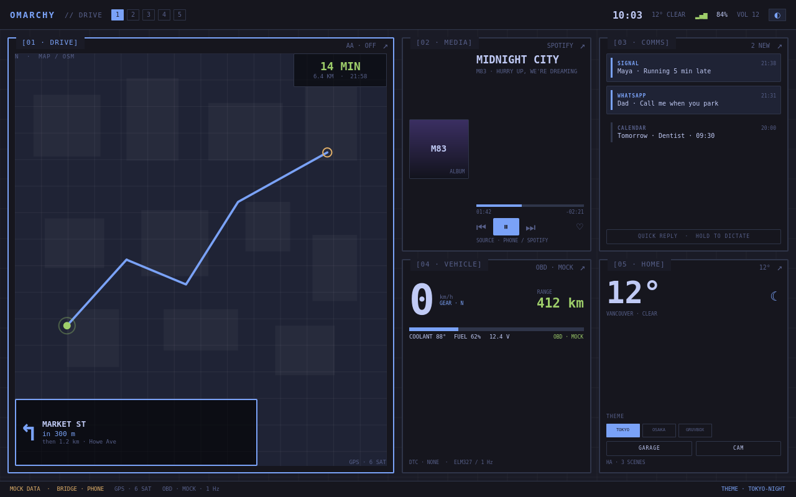

# Omarchy Auto

**An Omarchy-styled car head unit.** Five tiles — Drive, Media, Comms, Vehicle, Home — in the visual language of Omarchy/OmarchyTV, built with Qt Quick and designed to grow into a Quickshell shell on a Linux car computer.

> Working name. Also considered: Drivearchy, Omarchy Drive, Cararchy.



[Portrait layout](docs/img/shell-800x1280.png) · [Expanded Media](docs/img/expanded-media.png)

## Status

Prototype scaffold. The shell runs with fake data at 1280×800 and 800×1280;
theme switching, active-tile highlighting, and expanded tiles work. The phone
bridge, daemon, and Android Auto integration are planned, not built. The bridge
network/security design is proposed in ADR-0007; the tablet was offline for the
last host check.

## The idea in one paragraph

Android Auto is a projection protocol with Google/OEM-controlled templates. You can't install Omarchy into it or skin its launcher. So this project flips the relationship: **Omarchy is the host, the phone is the brain.** The first release is a custom car UI plus an Android companion app that sends notifications, media, GPS, and navigation handoff over Wi-Fi. Android Auto as an optional data source comes later, on hardware that can handle it.

## Quick start

The shell is a plain Qt 6 / Qt Quick app, so it runs as a window on a desktop
before it ever touches a car.

```sh
# from the project root
./shell/run.sh
```

`run.sh` finds a native `qmlscene`/`qml6`, the tablet's
`/usr/lib/qt6/bin/qmlscene`, Quickshell, or a PySide6 preview. If the host has
none of them, from the project root, the shortest path is a project-local
PySide6 environment:

```sh
python3 -m venv .venv
.venv/bin/pip install -r shell/requirements.txt
./shell/run.sh
```

Headless preview and screenshots:

```sh
.venv/bin/python shell/preview.py --size 800x1280
.venv/bin/python shell/preview.py --screenshot /tmp/omarchy-auto.png
.venv/bin/python shell/preview.py --expanded Media --screenshot /tmp/media.png
```

On a Quickshell host:

```sh
qs shell/quickshell.qml
```

## What's here

```
docs/BRIEF.md       product brief, scope, architecture, roadmap
docs/DECISIONS.md   the decisions and why
docs/HARDWARE.md    Tab 4 vs Pi 5 vs x86 vs Android head unit
docs/PROMPT.md      the original brief and a better version
docs/REFERENCES.md  primary sources, versions, and licenses
docs/img/           rendered screenshots of the prototype
shell/              the Qt Quick prototype (five tiles, fake data)
  preview.py        PySide6 window runner and headless screenshot tool
daemon/             placeholder: MPRIS/BlueZ/OBD/GPS bridge
companion/          placeholder: Android companion app
```

## The five tiles

| Tile | v0.1 (mock) | v0.2 (live) |
|---|---|---|
| 01 Drive | Map, next maneuver, ETA | Phone GPS + nav handoff; later AA data |
| 02 Media | Art, transport, progress | MPRIS / MediaSession |
| 03 Comms | Notification list | Notification listener + quick reply |
| 04 Vehicle | Speed, RPM, range | OBD-II via ELM327 |
| 05 Home | Weather, theme switch | Home Assistant, day/night, camera |

## Next steps

1. Critique the rendered layouts (`docs/img/`) at 1280×800 and 800×1280.
2. Run the shell on the Tab 4 and measure FPS, RAM, and touch targets.
3. Pick the first live tile — media is the easiest win.
4. Review ADR-0007, then build the daemon and companion spike with WSS/mDNS.
5. Decide the car computer after the prototype, not before.

## License

TBD. Omarchy and OmarchyTV are MIT; keep their notices when reusing code or
themes. The optional Rust Android Auto crate is LGPL-3.0-or-later and LIVI is
GPL-3.0-or-later, so link/reference them deliberately if this becomes a public
project. See `docs/REFERENCES.md`.
