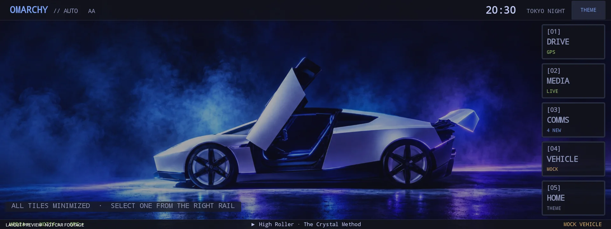

# Omarchy Auto

[](https://github.com/DonnieFi/omarchy-auto/actions/workflows/android.yml)
[](https://github.com/DonnieFi/omarchy-auto)
[](#architecture)
[](#architecture)
[](#phone-launcher)
[](LICENSE)

[](https://omarchyauto.com)
[](#build)
[](#android-auto--test-install)
[](#architecture)
[](CREDITS.md)

**An Omarchy-styled car UI for Android Auto and Android phones.** The car
display is the primary target: a Car App Library **NavigationTemplate** app.
On Android Auto the map surface draws the same right-side rail (`Drive / Media /
Comms / Home`) and large stage as the phone launcher. Drive holds the route
line, vehicle marker, compact speed, and attribution. Turn text, lane arrows,
and arrival time also use the host routing card. **Menu** opens the host list
hub; a cold start does not. The Vehicle tile is hidden until its data source
is real.



*Omarchy Auto with Tom Ballard's Tokyo Studio artwork, credited in
[`CREDITS.md`](CREDITS.md). Synthetic layout render, not real-car footage.
Project code is MIT-licensed; the artwork is third-party and credited
separately.*

## Status — public pre-alpha (2026-11-03)

Omarchy Auto is a pre-alpha project prepared for public source release. The
phone launcher and Android Auto dashboard are usable on a test device. The
routing alpha in `navigation-spike/` is a separate experimental app and is not
part of the dashboard release yet. The old Linux/Quickshell path remains in
`shell/` as future work.

Built and checked on this machine:

- `./gradlew assembleDebug` produces the dashboard APKs. The optional routing
  spike builds separately as `:navigation-spike:assembleDebug`.
- Phone launcher runs on an Android 15 emulator and a Samsung S24 FE (Android
  17). Theme switch, live MediaSession, live notifications, a GPS fix, stage
  selection, tile launch, Back return, and portrait/landscape rotation were
  exercised at 1280×720 and 1080×2400.
- The layout is a **narrow right-side rail of small tiles** plus one large
  content stage. Tap a rail tile to engage it. Media has in-app previous,
  play/pause, and next controls; the stage `OPEN` button launches the real app
  configured in Setup (`MEDIA TILE APP`).
- Android Auto 0.1.1 was verified on the owner's real Kia Android Auto screen
  over USB using Play Internal App Sharing. That build drew the phone-style
  shell on the car surface. Current source is **0.1.16** (versionCode 17). It
  keeps the OpenFreeMap dark basemap, the unified `MEDIA TILE APP` selector,
  and opt-in crash reporting / `SEND LOGS`. The Android Auto surface draws
  that same five-tile shell again. **Menu** opens the host list hub; a cold
  start does not. Host templates still carry the maneuver, lanes, and ETA.
  Drawing the shell on a navigation-only surface is a known quality-guideline
  risk and has not had a new head-unit pass.
- The Desktop Head Unit was attempted, but the emulator image's Android Auto
  app is a Play Store stub and the image has no Play Store.

Live data is ordered as requested: clock + theme, now playing (MediaSession),
notifications (NotificationListener), GPS speed, and battery level/charging. The
Vehicle tile is hidden behind `FeatureFlags.SHOW_VEHICLE_TILE`; Torque is
intentionally not wired up yet. The phone launcher still draws its own title
and footer. Android Auto draws that same shell on the map surface. The host
still supplies the routing card and the action strips.

## Build

Prerequisites: JDK 17+ and Android SDK platform 37.

Toolchain: Gradle **9.8.2**, AGP **9.5.0**, built-in Kotlin (no separate KGP),
compileSdk **37**, targetSdk **36**. CI uses the current action runtimes
(`checkout@v7`, `setup-java@v6`, `setup-gradle@v6`, `upload-artifact@v7`) on
`ubuntu-26.04`; there is no Node/JavaScript app in this repository.

```sh
export ANDROID_HOME=/path/to/android-sdk
./gradlew assembleDebug
```

Tom Ballard’s Tokyo Studio image is tracked as the Tokyo Night theme
background, so default builds include it. The private local-override flag is
only needed for an owner-specific image:

```sh
./gradlew assembleDebug -Pomarchy.includeLocalAssets=true
```

Default builds exclude `local-assets/`; that flag is for private overrides, not
for Tom’s image. Before a public-track release, run the asset guard:

```sh
./gradlew verifyPublicReleaseAssets
```

It builds the release archives and fails if any `local-assets/` file appears in
them. APKs:

```text
auto/build/outputs/apk/debug/auto-debug.apk
launcher/build/outputs/apk/debug/launcher-debug.apk
navigation-spike/build/outputs/apk/debug/navigation-spike-debug.apk
```

They are debug-signed. Verify with:

```sh
$ANDROID_HOME/build-tools/37.0.0/apksigner verify --print-certs \
  auto/build/outputs/apk/debug/auto-debug.apk
```

A clean clone only needs `ANDROID_HOME` (or `local.properties` with
`sdk.dir=...`). `local.properties` is ignored.

## Install and run

```sh
adb install -r auto/build/outputs/apk/debug/auto-debug.apk
adb install -r launcher/build/outputs/apk/debug/launcher-debug.apk
# Optional routing spike:
adb install -r navigation-spike/build/outputs/apk/debug/navigation-spike-debug.apk
```

### Phone launcher

```sh
adb shell am start -n com.omarchy.auto.launcher/.MainActivity
```

Or choose **Omarchy Auto Launcher** as the home app. It is a rail-and-stage
demo launcher, not a full app drawer.

The app opens with **all tiles minimized** — including Drive/navigation — so the
wallpaper is the first thing you see. Tap a rail tile to expand it; tap the same
tile again to minimize. The stage has an `OPEN` action for real apps:

| Rail tile | Stage | OPEN action |
|---|---|---|
| Drive | MapLibre/OpenFreeMap map, live GPS, and an OSRM route when navigation is active | Google Maps |
| Media | large now-playing/audio art + play/pause | selected in Setup: auto, Spotify, YouTube Music, YouTube, ChatGPT, Grok, etc. |
| Comms | large notification list | default SMS app |
| Vehicle | hidden until OBD/Torque is real | none — deferred |
| Home | clock, theme chips, setup | Android Settings |

Back from the launched app returns to the launcher. The phone top-right
`THEME` button opens the Home theme picker with ten themes: Tokyo Night, Osaka
Jade, Gruvbox, Catppuccin, Kanagawa, Everforest, Nord, Ethereal, Ristretto,
and Hackerman. Tokyo Night uses Tom Ballard’s Tokyo Studio image; the other
themes load their matching Omarchy background. Setup also offers `MEDIA TILE
APP`, `SEND LOGS`, `CHOOSE BACKGROUND`, `USE TOM BACKGROUND` (private builds),
and `USE THEME BACKGROUNDS`; a custom choice overrides every theme until it is
reset. The Android Auto app and the phone launcher are separate packages, so
choose the background, media target, and notification text size in each app's
Setup if you use both.

A `geo:` link opened on the phone shows **START ROUTE** / **NOT NOW** and does
not start guidance until you confirm. The same link delivered to the car
service (`ACTION_NAVIGATE`) starts immediately. While a car session is
connected and the host has not reported parked, the phone hides its web stage,
custom keyboard, and notification list. A stop in traffic does not unlock
them. Ending the session clears that lock. The theme picker stays on the phone;
the car action strip does not open it.

### Routing alpha (optional)

`:navigation-spike` is a separate experimental app (`com.omarchy.auto.navspike`)
for evaluating turn-by-turn with Ferrostar and hosted Valhalla. It is not part
of the dashboard APK and does not replace the Drive stage yet.

```sh
./gradlew :navigation-spike:assembleDebug
adb install -r navigation-spike/build/outputs/apk/debug/navigation-spike-debug.apk
adb shell am start -n com.omarchy.auto.navspike/.SpikeActivity
```

Use the owner's own Stadia Maps key at runtime for live routing; no API key is
embedded. The debug build also has a keyless recorded-route replay:

```sh
adb shell am start -n com.omarchy.auto.navspike/.ReplayActivity
```

Emulator tests prove the native engine, guidance events, off-route detection,
and replay UI. Live routing, audible speech, real GPS and the Android Auto head
unit remain follow-up validation.

### Roadster background

Setup's background picker is the supported path. Tom Ballard’s Tokyo Studio
image is tracked at `core/src/main/assets/themes/tokyo-night.webp` and is the
default Tokyo Night background in normal debug and release builds. `USE TOM
BACKGROUND` locks that image across theme changes; `USE THEME BACKGROUNDS`
returns to the active theme’s bundled image. `local-assets/` remains optional
for owner-specific private overrides with
`-Pomarchy.includeLocalAssets=true`, but it is no longer required for Tom’s
image. See [`docs/ASSETS.md`](docs/ASSETS.md).

### Permissions

The phone launcher has a Home-tile `SETUP · PERMISSIONS` button. The Android
Auto APK also has a **Setup** launcher icon with the same permissions,
`MEDIA TILE APP` target selector, background controls, and `SEND LOGS` button.
The same grants can be made with ADB:

```sh
adb shell cmd notification allow_listener \
  com.omarchy.auto/com.omarchy.auto.core.OmarchyNotificationListener
adb shell cmd notification allow_listener \
  com.omarchy.auto.launcher/com.omarchy.auto.core.OmarchyNotificationListener
adb shell pm grant com.omarchy.auto android.permission.ACCESS_FINE_LOCATION
adb shell pm grant com.omarchy.auto.launcher android.permission.ACCESS_FINE_LOCATION
```

Notification access enables both the Comms tile and MediaSession discovery.
Without it the UI says so instead of inventing data.

### Android Auto — test install

Current test build: **0.1.16** (versionCode 17). Build the signed AAB with:

```sh
./gradlew :auto:bundleRelease
```

Android Auto does not trust an ADB-sideloaded Car App Library app. The
documented test route is **Play Internal App Sharing**, which installs from
Play without a public listing or review. The **0.1.12** AAB includes MapLibre
native libraries, the tracked Tokyo Studio Tokyo Night background, the unified
`MEDIA TILE APP` selector in Setup, and `SEND LOGS` / crash reporting.

The car app declares only the Car App Library **NAVIGATION** category. It
draws into `NavigationTemplate` through `AppManager.setSurfaceCallback`. The
canvas is the Omarchy five-tile shell: theme wallpaper, title, footer, the
right-hand rail, and the open stage. A cold idle start shows that shell and
does not push a host list. Drive is the map, with the route, vehicle marker,
compact speed, and the OpenFreeMap / OSM credit. Maneuver text, lane arrows,
and the travel estimate are also host `RoutingInfo` and `TravelEstimate`.
Theme, media, notifications, search, and settings are on the shell. Search on
the action strip is still a host `SearchTemplate`; the host keeps that
keyboard parked-only while voice input and result rows still work while
driving. **Menu** is the only way to open the host hub, a `ListTemplate` with
Map, Search, Media, Notifications, and Settings. The hub stays over the map,
so the navigation session and trip updates continue while Media or Settings
are open; **Map** pops back to the live map. A NAVIGATE or coordinate geo
intent pops to that map and opens the Drive stage. The main strip is Search,
Menu, and Heading while idle. End is added while a route is active. Reroute
replaces Heading when the car is off the route. Retry replaces it on
route/location errors. The map strip is icon-only: zoom in, zoom out,
recenter, and pan. Video and browser stages are not drawn on the car surface.

This shell conflicts with the car app quality guidelines for a navigation-only
app (a map-only surface, host templates for search and messages). That risk is
accepted. It is not an SDK restriction.

> **Sideloading caveat:** current Google documentation says the Android Auto
> "Unknown sources" developer option applies to media, messaging, and parked
> apps, but *not* to Car App Library apps. There is also a 2026 field report of
> sideloaded navigation apps disappearing from the AA launcher. Internal App
> Sharing / an Internal Test Track is the documented private test route. The
> debug build uses `HostValidator.ALLOW_ALL_HOSTS_VALIDATOR`; the release build
> now allows the official AA host certificates. The car path has been seen on
> the owner's Kia with 0.1.1; use Internal App Sharing for each new build and
> verify the new surface changes on the car.

## Architecture

```text
core/                         shared Kotlin Android library
  Theme.kt                    10 Omarchy palettes + background ids
  Model.kt                    TileId, DashboardState, MediaSnapshot, NotificationItem
  TileRenderer.kt             Canvas renderer; phone and Android Auto share the shell
  CarPlatformPolicy.kt        shell on both surfaces; web stages stay off Android Auto
  DistractionLock.kt          car-session lock until the host reports parked
  NavigationController.kt     OSRM route, lanes, off-route, held ETA
  NavigateIntent.kt           geo and google.navigation parsing
  LiveDataStore / Controller  in-process state and source lifecycle
  MediaWatcher                MediaSessionManager + MediaController
  OmarchyNotificationListener NotificationListenerService
  LocationWatcher             GPS speed + held heading at low speed + last-known seed
  MapFollowPolicy.kt          snapshot refresh while following or panned
  MapSnapshotController       MapLibre/OpenFreeMap snapshots at the stage size
  MapSnapshotStore / Viewport latest map bitmap, size + staleness
  LaunchTargetStore           persisted Media tile app target
  SetupActivity               permissions, media target, backgrounds, logs, phone route confirm
  diag/                       opt-in crash reporting, ring buffer, LogShare

auto/                         Android Auto app (com.omarchy.auto)
  OmarchyCarAppService        CarAppService, foreground live-data service
  OmarchyScreen               root NavigationTemplate, routing card, action strips
  CarHomeScreen               host ListTemplate hub: Map, Search, Media, Notifications, Settings
  CarMediaScreen              driving-safe now playing + play/pause/next/previous
  CarCommsScreen              notification list (titles) + parked-only detail
  PlaceSearchScreen           host SearchTemplate (voice while driving; host keyboard parked-only)
  CarSettingsScreen           host settings ListTemplate (theme, map, phone setup, about)
  NavigationAlerts            guidance notification, separate from the foreground service
  AaosHostUx                  AAOS parked/driving reflection; absent on phones
  CarSurfaceRenderer          Surface.lockCanvas -> TileRenderer shell path

launcher/                     phone launcher (com.omarchy.auto.launcher)
  MainActivity                immersive launcher, app intents
  TileView                    shared renderer + hit testing
```

No Compose or QML runtime is on the car surface. `shell/` remains the QML
prototype for future Linux work.

## What works

| Area | Status |
|---|---|
| Five-tile layout, cut-out legends, mono type, 2px borders | Phone launcher and the Android Auto map surface |
| Themes | 10 Omarchy palettes + matching backgrounds (Tokyo Night: Tom Ballard); phone switch verified |
| Background | Custom image picker, bundled Tom background, or theme backgrounds; custom choice survives theme changes |
| Bars | Phone and Android Auto title and footer. The host still draws the routing card and action strips |
| Clock | Live; idle redraws align to the next minute, media progress stays 1 Hz |
| Battery | Footer icon + percentage; charging accent; state-driven redraw |
| Media | Live MediaSession metadata/art/progress + `MEDIA TILE APP` target selector in Setup for both packages |
| Notifications | Live listener + existing-notification load; OTP/2FA and banking filter; optional package allow-list; bodies not logged |
| GPS speed | Location/GPS speed; launcher got a fix at 0 km/h on the bench |
| Vehicle | Hidden by `FeatureFlags.SHOW_VEHICLE_TILE` until OBD/Torque is real |
| Right rail + large stage | Phone launcher, and the Android Auto surface. Phone verified on emulator and phone; the restored car shell has not had a head-unit pass |
| Rotation | Portrait/landscape reflow verified on the S24 FE |
| Media play/pause/previous/next | Phone launcher and the Android Auto media tile via MediaTransport |
| AA NavigationTemplate + SurfaceCallback | Five-tile shell on the map surface. 0.1.1 shell was seen on a Kia; this restoration has no new head-unit pass |
| AA host cards and strips | Routing card, travel estimate, search (host keyboard parked-only, voice while driving), Menu-opened hub, map zoom/recenter/pan; unit-tested |
| Turn-by-turn | Public OSRM demo, roundabout exit, lane arrows when OSM has them, off-route message until Recalculate, ETA held across small changes |
| Real map | OpenFreeMap dark style via MapLibre snapshots on the phone Drive stage and the AA map surface, plus a live location puck |
| Diagnostics | Opt-in crash queue + `SEND LOGS` share button in Setup |
| Routing alpha | Separate Ferrostar + hosted Valhalla app; emulator replay/UI tests pass; live key/car validation pending |
| Notification detail | Full-screen card overlay; S/M/L text size in Setup; phone verified |
| Stage OPEN + Back | Verified with YouTube Music/Maps path |
| README hero | `docs/img/hero-tokyo-night.webp` (Tom Ballard Tokyo Studio render, credited) |

## Verification

- `./gradlew assembleDebug` — passes; both APKs are debug-signed.
- Emulator: Android 15 Google APIs, API 35.
- Phone launcher: 1280×720 landscape and 1080×2400 portrait screenshots.
- Car previews: rendered at 1920×720, 1280×720, and 800×480; rail, full-bleed
  top bar, footer, 10-theme grid, and Drive map fit without clipping. Synthetic
  renders are captioned and are not car footage.
- Theme button changed Tokyo Night → Gruvbox/Hackerman.
- Background picker: selected an image, enabled it, changed the theme, and
  confirmed the custom image survived; reset to theme backgrounds.
- Notification text S/M/L applied to Comms rows; LARGE and SMALL previews
  checked at 800×480.
- Media tile showed a real MediaSession from YouTube Music playing a local test
  WAV; progress/play state updated.
- Comms tile showed a real system notification posted with `cmd notification`
  plus existing notifications after listener reconnect.
- Tile-to-YouTube-Music and Back-to-launcher verified.
- GPS provider returned a fix; speed read zero while stationary.
- Android Auto host: 0.1.1 verified on the owner's real Kia screen with the
  phone-style shell. The restored shell and the Ferrostar routing alpha still
  need that car pass.
- Unit tests on this tree: `./gradlew :core:testDebugUnitTest :auto:testDebugUnitTest`
  (61 tests, 0 failures on 2026-11-10). Those tests do not drive a head unit.
- Routing spike: `:navigation-spike:assembleDebug`, JVM tests, lint and native
  emulator tests pass. Live Stadia routing, audible speech, real GPS and the
  Android Auto head unit remain unverified.
- Real map: MapLibre snapshot of `https://tiles.openfreemap.org/styles/dark`
  with a live location puck and OpenStreetMap/OpenFreeMap attribution. Route
  geometry is a separate OSRM request, drawn on top of that snapshot. It has
  not been driven on a head unit.

## Limitations

- The restored Android Auto shell and its OSRM guidance still need a real-car
  acceptance pass. 0.1.1 was verified there with the older shell. Drawing this
  shell on a NAVIGATION-only surface does not follow the car app quality
  guidelines.
- Sideloaded Car App Library availability is subject to Google's host policy;
  use Play Internal App Sharing for the trusted install.
- The Android Auto canvas draws the rail, the drive-stage maneuver card, the
  map-search keyboard, and the notification list. It does not draw the video
  or browser stage. The phone hides its own distracting paths until the host
  reports parked or the car session ends.
- Routing uses the public OSRM demo (`router.project-osrm.org`) and address
  search uses Photon, then Nominatim. A route sends the current fix and the
  destination to that demo. There is no toll exclusion and no posted speed
  limit. Lane arrows appear only when the response includes turn lanes.
  Driving more than 40 m off the line for two fixes shows an off-route message
  and waits for Recalculate. The displayed ETA holds until the step changes or
  the estimate moves by about 30 seconds.
- `NavigationTemplate` still requires an action strip. The strip is navigation
  controls (search, menu, heading or recalculate, stop), not a theme button.
  Theme and settings are on the shell. The map strip is icon-only.
- The routing alpha has not been validated with a live Stadia key, audible
  speech, real GPS, or a real Android Auto head unit. Its replay tests are not
  a claim of fresh routing quality.
- Media controls send play/pause, previous, and next through MediaController.
- Notification privacy is documented in
  [`docs/NOTIFICATION-PRIVACY.md`](docs/NOTIFICATION-PRIVACY.md); OTP/2FA and
  banking filtering plus the optional allow-list are implemented.
- Redraw budget and remaining 30-minute car measurements are documented in
  [`docs/PERFORMANCE.md`](docs/PERFORMANCE.md).
- Location privacy: when the map is showing, the phone's location is sent to
  OpenFreeMap tile servers to render the basemap. Starting a route also sends
  the origin and destination to the public OSRM demo, and address search sends
  the query to Photon or Nominatim. Omarchy Auto does not store a location
  history. There is no map-off switch yet.
- Vehicle data is mock and the tile is hidden until OBD-II; Torque is not
  wired up.
- The Tokyo Studio artwork is included in the README, public site, and app
  builds with Tom Ballard’s permission and credit. Other Omarchy-derived theme
  backgrounds still need per-image rights checks before a public release.
- No public Play listing, store review, or production launch yet. The public
  source release is being prepared; see the publication gates below.
- Linux/Quickshell remains future work; it is not in the APKs.

## Publication gates

Before flipping the repository or app to public:

- Confirm the media rights for the nine Omarchy-derived theme backgrounds
  (`omarchy-jnn.7`). Tokyo Studio is cleared with Tom Ballard's permission.
- Complete the real-car dashboard and routing-alpha passes and capture dated
  evidence.
- Finish the Android Auto host allowlist check and the public Play listing.
- Keep the routing alpha keyless by default; live routing needs each tester's
  own Stadia key or a separately designed server.
- Review [`THIRD_PARTY.md`](THIRD_PARTY.md), [`CREDITS.md`](CREDITS.md) and
  [`docs/ASSETS.md`](docs/ASSETS.md) in the public tree.

## License

Project code and original assets are released under the [MIT License](LICENSE).
See [`CREDITS.md`](CREDITS.md) for Tom Ballard's Tokyo Studio artwork, Omarchy
theme credits, and third-party asset notes. The MIT license does not relicense
third-party artwork. AndroidX / Car App Library is Apache-2.0. Full component
notices are in [`THIRD_PARTY.md`](THIRD_PARTY.md).
